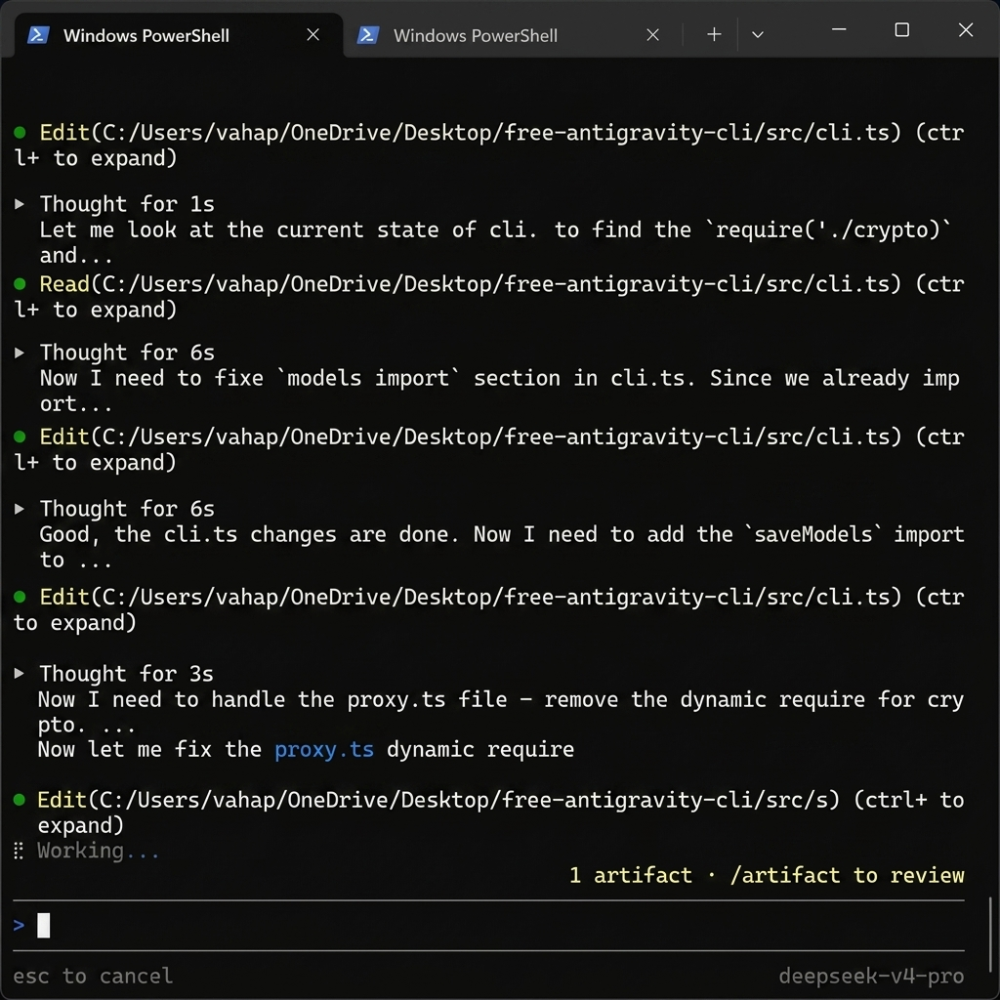

# Free Antigravity CLI

[](https://www.npmjs.com/package/free-antigravity-cli)
[](LICENSE)
[](https://github.com/vahapogut/free-antigravity-cli/stargazers)

**Open Source Community Edition** — Wraps the official [Antigravity CLI](https://antigravity.google/cli) (`agy`) with custom AI model support.

Use **OpenAI, Anthropic, Ollama, OpenRouter, Google AI Studio, and any OpenAI-compatible provider** alongside Gemini models — all through the native `agy` CLI experience.

<p align="center">
  
</p>

<p align="center"><i>Use OpenAI, Claude, Llama and more inside the native agy CLI</i></p>


## Quick Links

* [How It Works](#how-it-works)
* [Quick Start](#quick-start)
* [Prerequisites](#prerequisites)
* [Commands](#commands)
* [Supported Providers](#supported-providers)
* [Installation](#installation)
* [Configuration](#configuration)
* [Technical Details](#technical-details)
* [Update Resilience](#update-resilience)
* [Development](#development)
* [Testing](#testing)
* [Troubleshooting](#troubleshooting)
* [FAQ](#faq)
* [Changelog](#changelog)
* [Security](#security)
* [Comparison](#comparison)
* [Contributing](#contributing)
* [Acknowledgments](#acknowledgments)
* [License](#license)


## How It Works

```
antigravity
  ├── Starts local proxy (port 50998)
  ├── Auto-patches agy.exe to route through proxy
  └── Delegates to agy CLI
        ├── Google models → daily-cloudcode-pa.googleapis.com (transparent)
        └── Custom models → injected by proxy into model list
```

The CLI is a thin wrapper: it starts a local HTTP proxy that intercepts `fetchAvailableModels` API calls, injects your custom model definitions, then hands off to the official `agy` CLI. You get the full native Antigravity CLI experience plus custom models.


## Quick Start

```bash
# 1. Install official Antigravity CLI first
curl -fsSL https://antigravity.google/cli/install.cmd -o install.cmd && install.cmd && del install.cmd

# 2. Install Free Antigravity CLI
npm install -g free-antigravity-cli

# 3. Add your custom models
antigravity custom-models add

# 4. Start chatting (all models appear in agy's model selector)
antigravity
```


## Prerequisites

* **Node.js** >= 18
* **Official Antigravity CLI** (`agy`) installed at one of the default locations
* **Google Account Sign-In**: The CLI uses the desktop Antigravity app's authentication. You must be signed in to [Antigravity Desktop](https://antigravity.google) first. The CLI does not have its own login flow.
  * **Windows**: `%LOCALAPPDATA%\agy\bin\agy.exe`
  * **macOS**: `~/Library/Application Support/agy/bin/agy` or `~/.local/share/agy/bin/agy`
  * **Linux**: `~/.local/share/agy/bin/agy`
* **Custom Binary Path**: If you installed `agy` in a custom location, you can set the path using the `AGY_BIN` environment variable:
  ```bash
  export AGY_BIN="/path/to/custom/agy"
  ```


## Commands

```
antigravity                              Start interactive chat (proxy + agy)
antigravity chat                         Same as above
antigravity custom-models list           List configured custom models
antigravity custom-models add            Add a new custom model (interactive wizard)
antigravity custom-models remove <name>  Remove a custom model
antigravity custom-models import         Import models from desktop Antigravity
antigravity restore                      Put the original agy binary back
antigravity configure                    Show configuration info
antigravity version                      Show version
antigravity help                         Show this help
```

`antigravity models list|add|remove|import` still works as the older name for `custom-models`.

### Options
* **`--verbose` / `--debug`**: Can be passed to any command to enable proxy request logging for troubleshooting. Credentials (the `Authorization` header, API keys) are not printed.

Any arguments not listed above are passed directly to the `agy` CLI. That includes `agy`'s own `models` command: `antigravity models` lists the models agy sees, custom ones included. To pass an argument that the wrapper would otherwise handle itself, put it after `--`:

```bash
antigravity -- --help    # agy's help instead of the wrapper's
```


## Supported Providers

| Provider | CLI Value | Auth |
|---|---|---|
| **OpenAI** | `openai` | API Key (`sk-...`) |
| **Anthropic** | `anthropic` | API Key (`sk-ant-...`) |
| **Google AI Studio** | `google` | API Key (`AIza...`) |
| **Ollama (Local)** | `ollama` | None |
| **OpenRouter** | `openrouter` | API Key |
| **DeepSeek** | `deepseek` | API Key |
| **Groq** | `groq` | API Key |
| **Mistral** | `mistral` | API Key |
| **Cerebras** | `cerebras` | API Key |
| **Kimi (Moonshot)** | `kimi` | API Key |
| **Fireworks AI** | `fireworks` | API Key |
| **LM Studio (Local)** | `lmstudio` | None |
| **llama.cpp (Local)** | `llamacpp` | None |
| **NVIDIA NIM** | `nvidia` | API Key |
| **Custom (OpenAI-compatible)** | `custom` | API Key |


## Installation

### npm (Recommended)

```bash
npm install -g free-antigravity-cli
antigravity
```

### From Source

```bash
git clone https://github.com/vahapogut/free-antigravity-cli.git
cd free-antigravity-cli
npm install
npm run build
npm link
antigravity
```


## Configuration

Models are stored in `~/.free-antigravity/models.json`:

```json
{
  "models": [
    {
      "name": "models/gpt-4o",
      "displayName": "GPT-4o (OpenAI)",
      "provider": "openai",
      "apiKey": "sk-...",
      "apiUrl": "https://api.openai.com/v1/chat/completions",
      "externalModelName": "gpt-4o"
    },
    {
      "name": "models/claude-opus-4-7",
      "displayName": "Claude Opus 4.7",
      "provider": "anthropic",
      "apiKey": "sk-ant-...",
      "apiUrl": "https://api.anthropic.com/v1/messages",
      "externalModelName": "claude-opus-4-7"
    },
    {
      "name": "models/llama3",
      "displayName": "Llama 3 (Local)",
      "provider": "ollama",
      "apiKey": "none",
      "apiUrl": "http://localhost:11434/v1/chat/completions",
      "externalModelName": "llama3"
    }
  ]
}
```

A key you write into this file in clear text is encrypted the next time the CLI starts; saved keys look like `local-gcm:...`. See [How API Keys Are Protected](#how-api-keys-are-protected).

Set `FREE_ANTIGRAVITY_HOME` to keep these files in a different directory.

### Importing from Desktop Antigravity

```bash
antigravity custom-models import
```

> **NOTE:** The desktop app encrypts its API keys for itself, so the CLI cannot read them. Those models are imported without a key, and the command lists them. Enter their keys again with `antigravity custom-models add`.


## Technical Details

### Binary Patching

On first run, the CLI patches `agy` so that its Cloud Code endpoint points at the local proxy:

```
https://daily-cloudcode-pa.googleapis.com  → http://localhost:50998/v1internal/xxxxxxx
```

* **One endpoint, same length**: The replacement is exactly as long as the original URL, so nothing else in the binary moves. Only this endpoint is redirected. If a build does not contain it, the production host (`https://cloudcode-pa.googleapis.com`) is redirected instead. Sign-in and all other Google URLs are never changed.
* **One backup**: The original binary is saved first, with the agy version and a timestamp in its name (e.g. `agy.exe.bak-1.2.3-2026-05-25T00-30-28-323Z`). `agy` is about 150 MB, so only the original of the installed build is kept: when agy updates itself and is patched again, the previous backup is removed.
* **Check and undo**: `agy --version` must answer before the patch and still answer after it. Each check may take up to 30 seconds, because the first start of a file that has just changed is slow. If the patched binary does not answer, the original is copied back and the problem is printed.
* **Restore**: `antigravity restore` puts the newest unpatched backup back.

`agy` then sends its Cloud Code requests (`fetchAvailableModels`, `streamGenerateContent`, etc.) through the local proxy, where custom model definitions are injected into both the `models` list and `agentModelSorts` (required for models to appear in the agy model selector).

> **While `agy` is patched, start it through `antigravity`.** Plain `agy` would send its requests to a proxy that is not running. Run `antigravity restore` to get the original back. When agy updates itself, the new binary is patched on the next start.

Patches written by earlier versions for port 50999 are moved to the current port.

**Port Isolation:** The CLI proxy uses port **50998** by default, separate from the desktop Antigravity proxy on port 50999. Both can run simultaneously without conflict. If port 50998 is busy, the proxy falls back to a dynamic port automatically.

#### macOS Code Signing and Quarantine
On macOS, patching the binary invalidates its code signature. The CLI automatically runs ad-hoc self-signing via `codesign` and clears macOS quarantine flags via `xattr` to ensure the patched binary runs without OS security alerts.

### Proxy Server

The proxy runs on `http://127.0.0.1:50998` (with automatic fallback if busy) and:

1. **Intercepts `fetchAvailableModels`**: Merges custom model definitions into both `models` and `agentModelSorts` in the response
2. **Intercepts `generateContent`/`streamGenerateContent`**: Routes custom model requests to external APIs with format translation
3. **URL normalization**: Strips binary patch padding from incoming requests before forwarding to Google
4. **Translates formats**: Gemini ↔ OpenAI / Anthropic / Ollama / Google AI Studio
5. **Transparent forwarding**: All other requests pass through to Google unchanged
6. **Graceful fallback**: If the Google API is unreachable, returns custom models directly with proper sort ordering

**Local only.** The proxy listens on `127.0.0.1`. It answers only requests addressed to its own `Host`, refuses requests that come from a web page (an `Origin` of another site), and sends no CORS headers. A site open in your browser cannot use it.

### Provider Translation

| Provider | Request Translation | Response Translation | Streaming |
|---|---|---|---|
| **OpenAI** | Gemini → Chat Completions | Chat Completions → Gemini | SSE delta → Gemini chunks |
| **Anthropic** | Gemini → Messages API | Messages → Gemini | SSE events → Gemini chunks |
| **Ollama** | Gemini → OpenAI-compatible | OpenAI → Gemini | Same as OpenAI |
| **Google AI Studio** | Passthrough (native Gemini) | Passthrough | SSE chunks |
| **OpenRouter** | Same as OpenAI | Same as OpenAI | Same as OpenAI |
| **Custom** | Same as OpenAI | Same as OpenAI | Same as OpenAI |


## Update Resilience

`agy` updates itself often. This is how the CLI keeps working across those updates:

| Feature | Description |
|---|---|
| **Same-length patch** | The Cloud Code endpoint is found in each new binary and replaced by a local URL of the same length. No offsets or version tables are involved. |
| **One backup** | Each patch first saves the original, tagged with the agy version and a timestamp, and removes the backup of the previous build. |
| **Check and undo** | After patching, `agy --version` must still answer. If it does not, the original is copied back and the problem is printed. |
| **Restore command** | `antigravity restore` puts the newest unpatched backup back. |
| **Published manifest** | The last agy version reported to work is published in this repository (`patch-manifest.json`). The CLI reads it at most once a day, with a cached and a bundled copy as fallback. |
| **Version notice** | On startup, the CLI tells you when your `agy` is newer than the last version reported to work. |

### How It Works

```
agy binary updated by Google
         ↓
free-antigravity-cli starts
         ↓
├─ Finds the Cloud Code endpoint in the new binary
├─ Saves the original, then writes the same-length local URL
├─ Checks that agy still starts
├─ Fail? → Original copied back, problem printed
└─ Success → Custom models available in agy selector
```

> **Note:** If a future `agy` build no longer contains this endpoint as plain text, the CLI leaves the binary unchanged and says so; custom models will then not appear. In that case, please [open an issue](https://github.com/vahapogut/free-antigravity-cli/issues).


## Development

The project uses **TypeScript** with ESLint and Prettier for code quality.

```bash
# Install dependencies
npm install

# Build
npm run build

# Run tests
npm test

# Lint
npx eslint src/

# Format
npx prettier --write src/
```

### Code Quality

| Tool | Purpose |
|---|---|
| **TypeScript** | Strict type checking (`tsc --noEmit`) |
| **ESLint** | Static analysis, no `require()` enforcement |
| **Prettier** | Consistent code formatting |
| **Jest** | Unit + integration tests |

---

## Testing

A comprehensive unit and integration test suite is provided using Jest to verify translation mechanics and proxy interception.

```bash
# Run tests
npm test
```


## Troubleshooting

**"You are currently not signed in" / "No models available"**

The CLI does not have its own login flow. You must sign in via the desktop Antigravity app first:

1. Open **Antigravity Desktop** (installed separately)
2. Sign in with your Google account
3. Close and reopen the CLI: `antigravity`

**"Port 50998 is already in use"**

A previous CLI session may still be running. Kill stale processes:

```bash
# Windows
taskkill //F //IM agy.exe

# macOS/Linux
pkill agy
```

**"Could not patch agy" / "The patched agy did not start"**

This can happen when Google updates `agy` and the patch doesn't apply cleanly, or when the file is in use. When the patched binary does not start, the CLI copies the original back by itself and prints what went wrong.

On Windows a program's file cannot be replaced while it runs, nor for a moment after it has exited. The CLI therefore tries again for about a second before it reports the file as in use. If the message stays, another `agy` is still running. That is not always a window: `agy` starts a background updater (`agy --bg-updater`) that can keep running after you close it. Wait for it to finish, or stop it with the commands above.

To go back to the original binary at any time:

```bash
antigravity restore
```

To restore by hand instead:

```bash
# Find the backup
ls ~/.local/share/agy/bin/agy.bak-*

# Restore (macOS/Linux)
cp ~/.local/share/agy/bin/agy.bak-<version>-<timestamp> ~/.local/share/agy/bin/agy

# Restore (Windows — PowerShell)
Copy-Item "$env:LOCALAPPDATA\agy\bin\agy.exe.bak-*" "$env:LOCALAPPDATA\agy\bin\agy.exe"
```

If the issue persists after a rollback, try updating `free-antigravity-cli`:

```bash
npm install -g free-antigravity-cli@latest
```

**Custom models not appearing in agy**

1. Verify models are added: `antigravity custom-models list`
2. Ensure API keys are valid (desktop-imported keys may need re-entry)
3. Restart the CLI after adding models


## FAQ

**Q: Is a Google account required?**

Yes. The CLI does not have its own login flow. You must sign in to the desktop Antigravity app first with a Google account. The CLI reuses that authentication.

**Q: Are my API keys safe?**

API keys are stored in `~/.free-antigravity/models.json`, encrypted with AES-256-GCM under a random key kept in `~/.free-antigravity/.credentials-key`. Both files are readable only by your user account. Keys are sent only to the provider you configured (e.g. OpenAI, Anthropic), never to Google or anyone else.

This keeps your keys out of backups, synced folders and shared copies of `models.json`. It does not protect them from software running under your own account, which can read the key file too. See [How API Keys Are Protected](#how-api-keys-are-protected).

**Q: Will this break when Google updates `agy`?**

Usually not. The CLI looks for the Cloud Code endpoint in each new binary, so most updates are handled on the next start, and a patch that leaves `agy` unable to start is undone. See [Update Resilience](#update-resilience) for details.

**Q: Can I use this without installing the official Antigravity CLI?**

No. This tool wraps the official `agy` CLI, which must be installed separately. The CLI patches `agy` at runtime to inject custom models.

**Q: Why are my desktop-imported API keys not working?**

Desktop Antigravity encrypts API keys for itself, so the CLI cannot read them. The import lists the models this applies to; enter their keys again with `antigravity custom-models add`.

**Q: Can I run the proxy on a different port?**

The proxy uses port **50998** by default. If that port is busy, it automatically falls back to a dynamic port. You do not need to configure this manually.

**Q: Does this work on macOS with Gatekeeper?**

Yes. On macOS, the CLI automatically re-signs the patched binary with `codesign --force --sign -` and clears quarantine flags with `xattr`. If you still see a security warning, you may need to allow it in **System Settings → Privacy & Security**.

**Q: How do I completely uninstall?**

```bash
# Put the original agy binary back first
antigravity restore

# Uninstall the CLI
npm uninstall -g free-antigravity-cli

# Remove configuration
rm -rf ~/.free-antigravity
```


## Changelog

### v1.2.0 (2026-11-11)

Security and correctness release. Thanks to @luanweslley77 for the reports (#1 to #6) and to @iOSDevSK for the Anthropic fixes and prompt caching (#7, #8).

- **security**: The local proxy now serves only the local `agy`. It checks `Host`, refuses requests from web pages, and sends no CORS headers (#4).
- **security**: Saved API keys are encrypted with AES-256-GCM under a random key file instead of a key derived from the user name. `models.json` and the key file are readable only by their owner (#3).
  - Keys saved by earlier versions are re-encrypted automatically on the first start.
  - Until then they were only obscured. If someone else could read your `models.json`, rotate those keys at the provider.
- **security**: `--verbose` no longer prints the `Authorization` header or API keys.
- **fix**: `agy` is started without a shell, so multi-word arguments arrive intact and the Node `DEP0190` warning is gone (#6).
- **fix**: `antigravity models` reaches the official `agy models` command. The wrapper's model management is now `antigravity custom-models`; the old `models list|add|remove|import` spellings still work (#5).
- **fix**: Patch problems are always printed. A patched binary that no longer starts is replaced by the original. `antigravity restore` undoes the patch (#2).
  - One backup of the original is kept next to `agy`, not one per update.
  - On Windows a file that is briefly in use is tried again for about a second instead of failing at once.
- **fix**: Only the Cloud Code endpoint is ever rewritten. The generic rewrite of other `googleapis.com` URLs is removed; it never ran in practice and would have damaged them.
- **fix**: The published patch manifest is actually loaded (the URL named a branch that does not exist), is cached for a day, and the version notice appears only for `agy` versions newer than the last one reported to work (#1).
- **fix (Anthropic)**: Valid `anthropic-version` header, numeric schema keywords, streamed tool arguments, one tool-call context per stream, and tool-call arguments passed through unchanged, so Anthropic models work with agy 1.4.x (#7).
- **feat (Anthropic)**: Prompt caching for requests to the Anthropic API (#8).
- **fix (Anthropic)**: `temperature` is no longer sent to current Claude models, which reject it.
- **fix**: The wrapper's own status lines go to stderr. Stdout carries only what `agy` prints, so `--output-format json` and `antigravity acp` can be read by other programs.
- **change**: `FREE_ANTIGRAVITY_HOME` overrides the configuration directory.
- Checked against `agy` 1.5.6 and 1.0.3 on Windows.

### v1.1.0 (2025-05-25)

- **feat**: Update-resilient binary patching system
  - Flexible `patchUrlFlexible()` with null-byte padding for variable-length URLs
  - Runtime `discoverGoogleUrls()` to find and patch new Google endpoints automatically
  - Versioned backups (`agy.exe.bak-<version>-<timestamp>`) for traceable rollback
  - Automatic rollback on patch failure via `rollback.ts`
- **feat**: Remote patch manifest loader (`manifest.ts`) with offline cache fallback
- **feat**: Agy version compatibility check on startup
- **test**: 9 new compatibility tests (`tests/compat.test.ts`)
- **docs**: Updated README with Update Resilience section, troubleshooting, and demo screenshot

### v1.0.20

- Initial stable release with support for 15+ providers
- Binary patching, proxy interception, and format translation
- Model management (add, remove, list, import from desktop)
- Streaming and non-streaming custom model requests


## Security

### Reporting Vulnerabilities

If you discover a security issue, please **do not open a public issue**. Instead, contact the maintainer directly at **vahap.ogut@outlook.com** or via [LinkedIn](https://www.linkedin.com/in/abdulvahap-ogut-343992398/).

### How API Keys Are Protected

| Layer | Protection |
|---|---|
| **Storage** | `~/.free-antigravity/models.json`, written with owner-only permissions (`0600`; on Windows the file inherits the permissions of your profile folder) |
| **Encryption** | AES-256-GCM under a random 256-bit key in `~/.free-antigravity/.credentials-key` (owner-only) |
| **Transport** | Sent only to the provider you configured (OpenAI, Anthropic, etc.) via HTTPS |
| **Memory** | Decrypted only when needed; not logged or persisted in plain text |

**What this does and does not protect.** The key file sits next to the data it protects. Encryption therefore keeps your keys out of backups, synced folders and copies of `models.json` that you share, but not from software running under your own user account. Back up `.credentials-key` together with `models.json`, or enter the keys again after restoring.

**Upgrading from 1.1.5 or earlier.** Those versions derived the encryption key from your user name, which is not a secret. Your saved keys are re-encrypted automatically the first time 1.2.0 starts. If anyone else could read your `models.json` before that, rotate those keys at the provider.

### Local Proxy Access

The proxy listens on `127.0.0.1` only. It accepts a request only when its `Host` header is the proxy's own address, refuses requests whose `Origin` is another site, and sends no CORS headers, so a web page open in your browser cannot use it. Other programs running on your computer can still reach it, as with any local service.

### macOS Code Signing

Patching the `agy` binary invalidates its original code signature. The CLI automatically:
1. Backs up the original binary
2. Applies the patch
3. Re-signs with `codesign --force --sign -`
4. Clears quarantine with `xattr -d com.apple.quarantine`

If you prefer not to patch, you can manually configure a system-wide proxy instead (advanced).

| Feature | Free Antigravity CLI | Google agy CLI |
|---|---|---|
| **Open Source** | Yes (Apache 2.0) | No |
| **Custom Models** | Yes | No |
| **OpenAI / Anthropic / Ollama** | Yes | No |
| **Gemini** | Yes | Yes |
| **All agy Features** | Yes (wraps agy) | Yes |
| **Size** | ~90 KB | 151 MB |
| **npm Install** | Yes | No |
| **Auto-updates** | Via npm | Built-in |
| **Update Resilience** | Yes (v1.1.0+) | N/A |


## Contributing

Pull requests welcome at [github.com/vahapogut/free-antigravity-cli](https://github.com/vahapogut/free-antigravity-cli).


## Acknowledgments

- Thanks to the **Antigravity** team for building the `agy` CLI that this project wraps.
- Thanks to all **contributors** who reported issues, tested patches, and submitted PRs.
- Special thanks to the **open-source AI community** for making multi-provider access possible.


## License

Apache License 2.0 - see [LICENSE](LICENSE).


## Author

**Developed By [Abdulvahap Ogut](https://www.linkedin.com/in/abdulvahap-ogut-343992398/)**
